# Panel de Asistencia de Comunicación

**PP3 · Grupo 7:** Cau Pablo Nicolás · Luciano Budman · Peralta Tatiana · Álvarez Nahuel

**MVP online:** https://panel-asistencia-comunicacion-front.vercel.app

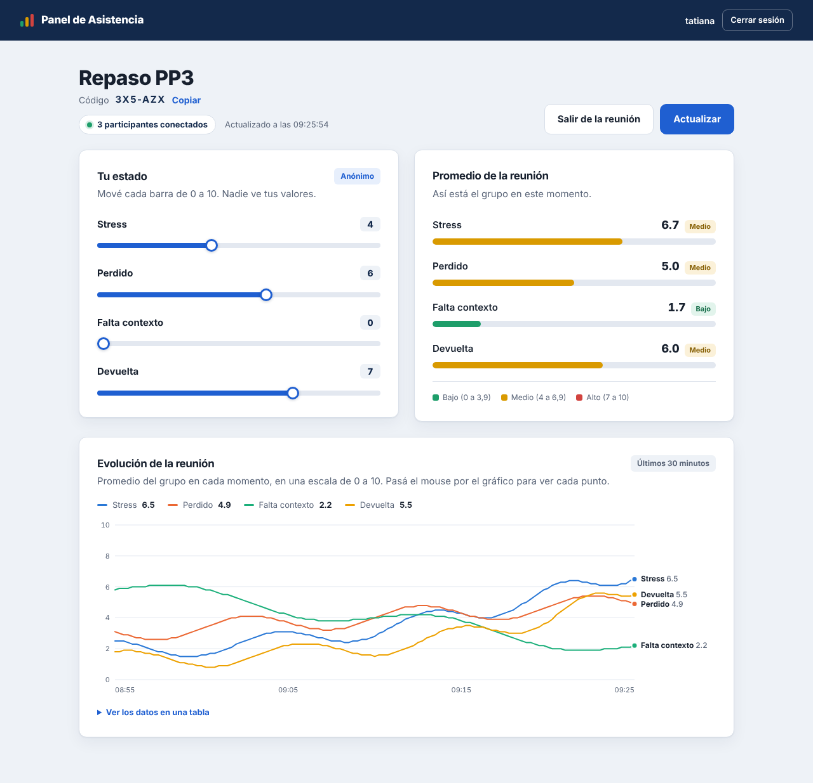

---

## 1. Descripción del proyecto

### ¿Qué queremos resolver?

El problema que tratamos de resolver es la falta de comunicación REAL que se da en Meets y ambientes virtuales.

¿Nunca te pasó que un profesor da una clase por Meet y ningún alumno se anima a preguntar?

Esto puede ocurrir por varios motivos, pero creemos que el motivo es simple: la comunicación es CASI unidireccional. Cuantos más miembros hay en una reunión, más se dificulta una comunicación fluida.

### Nuestra propuesta

Para mejorar la comunicación, se nos ocurrió hacer algo parecido al chat que acompaña al Meet, pero en una ventana aparte, donde TODOS los miembros de la reunión puedan saber cómo se sienten los demás (por ejemplo, su nivel de estrés o nerviosismo). Cada uno marca de forma anónima cómo está, y todos ven el promedio de la reunión. Si uno sabe que los otros miembros también están nerviosos o perdidos, se siente más habilitado para hablar, y eso mejora POTENCIALMENTE la comunicación.

| Entrada anónima (cada uno) | Salida promedio (todos ven) |
|---|---|
| Stress | X |
| Perdido | Y |
| Falta contexto | Z |
| Devuelta | W |

Si este producto, en una etapa preliminar, da resultados, conectándolo con otros sistemas podría mejorar la comunicación también fuera del Meet: en reuniones de Zoom, vivos de YouTube o capacitaciones virtuales.

### ¿Para quién es?

**Público objetivo:** institutos terciarios y universidades que dan clases virtuales en vivo (Meet, Zoom o Teams) a grupos numerosos de estudiantes. También puede usarse en capacitaciones virtuales de empresas y en reuniones de trabajo remotas con muchos participantes.

### Resumen técnico

El sistema está compuesto por **1 frontend** (el Panel de Asistencia, hecho en HTML, CSS y JavaScript y desplegado en Vercel) y **3 backends** hechos en Node.js con Express y desplegados en Render: un **API Gateway**, que es la única puerta de entrada y valida el JWT del usuario, y **2 APIs**, una de **Usuarios** (registro y login) y otra de **Status** (crea las reuniones, guarda los valores, calcula el promedio y arma el historial para el gráfico). Cada API tiene **su propia base de datos MongoDB** en MongoDB Atlas. El frontend se comunica con el API Gateway por HTTP/REST con JWT, el Gateway reenvía cada pedido a la API que corresponde agregando custom headers, y cada API se conecta solo a su propia base de datos.

---

## 2. Diagrama de arquitectura

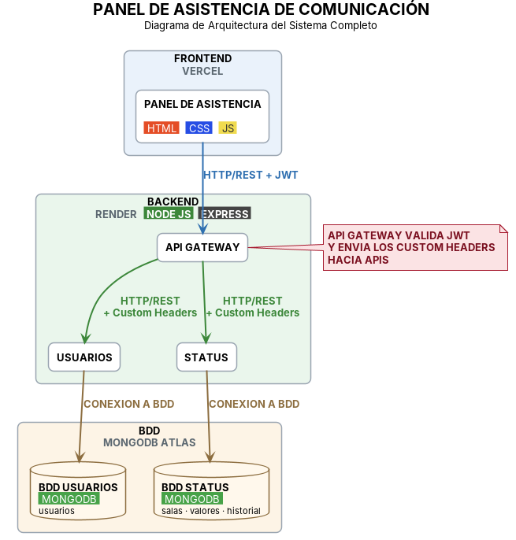

| Componente | Carpeta | Tecnología | Base de datos | Despliegue |
|---|---|---|---|---|
| Panel de Asistencia | `frontend/` | HTML, CSS, JavaScript | — | Vercel |
| API Gateway | `gateway/` | Node.js + Express | — | Render |
| API Usuarios | `servicio-usuarios/` | Node.js + Express + bcrypt | BDD Usuarios (MongoDB) | Render |
| API Status | `servicio-status/` | Node.js + Express | BDD Status (MongoDB) | Render |

---

## 3. Historias de usuario y diagramas de secuencia

Cada historia de usuario tiene su diagrama de secuencia. Los criterios de aceptación son los que probamos en el MVP.

### Diagrama 1 — Registro

**HU1.** Como **participante nuevo**, quiero **crear una cuenta con usuario y contraseña** para **poder entrar al panel**.

Criterios de aceptación:
- Si la contraseña tiene menos de 8 caracteres o falta algún dato, la app muestra un error (400).
- Si el usuario ya existe, la app muestra "Ese usuario ya existe" (409).
- Si los datos son válidos, se crea la cuenta (201) y la app vuelve al login con el usuario ya escrito.
- La contraseña nunca se guarda en texto plano: se guarda su hash con bcrypt.

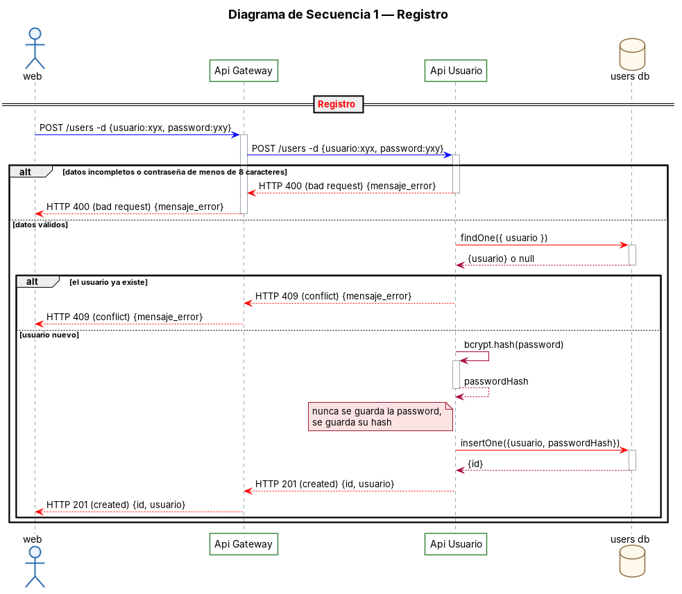

### Diagrama 2 — Login

**HU2.** Como **participante registrado**, quiero **iniciar sesión** para **unirme a una reunión de forma segura**.

Criterios de aceptación:
- Con usuario y contraseña correctos, la app recibe un JWT (201) y muestra la pantalla de Reuniones.
- Con datos incorrectos, la app muestra "Usuario o contraseña incorrectos" (401).
- El JWT dura 2 horas y viaja en cada pedido al API Gateway.

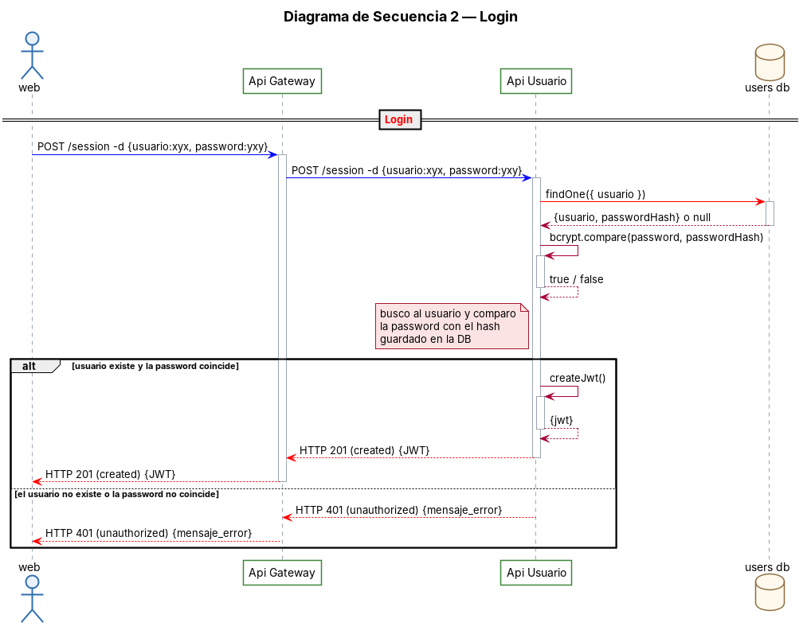

### Diagrama 3 — Medición promedio

**HU3.** Como **participante de una reunión**, quiero **marcar de forma anónima cómo estoy (stress, perdido, falta de contexto y devuelta)** para que **el grupo sepa cómo está la reunión sin saber quién es quién**.

Criterios de aceptación:
- Los 4 valores arrancan en 0 y van de 0 a 10.
- Mover un slider solo cambia el número en pantalla; los valores se envían al soltarlo y cada 15 segundos.
- La respuesta trae solo el promedio de cada variable y la cantidad de participantes, nunca los valores de una persona.
- Cada promedio muestra su nivel: Bajo (0 a 3,9), Medio (4 a 6,9) o Alto (7 a 10).
- Un valor fuera de 0 a 10 se rechaza con un 400.

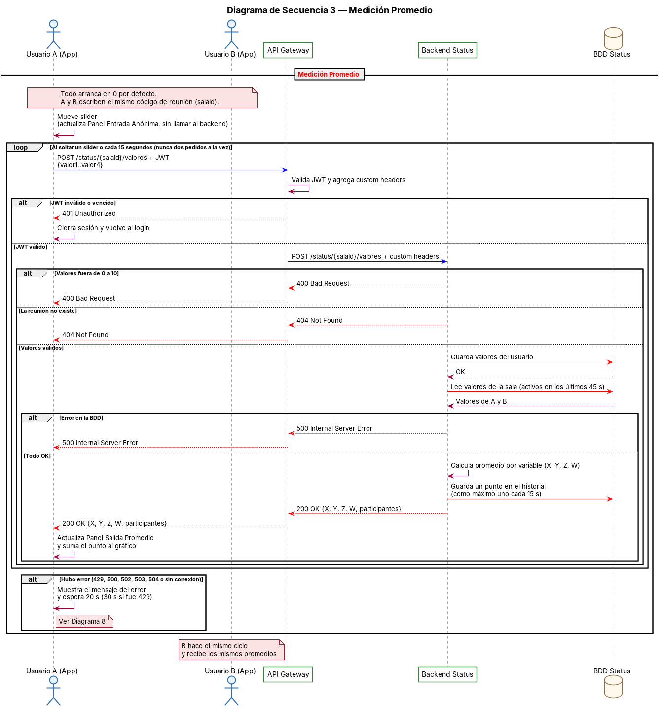

### Diagrama 4 — Crear reunión

**HU4.** Como **docente u organizador**, quiero **crear una reunión y recibir un código** para **compartirlo con los participantes**.

Criterios de aceptación:
- El nombre de la reunión tiene que tener entre 3 y 60 caracteres (si no, 400).
- El backend genera un código único de 6 caracteres (ej: K7M-4QP), sin letras que se confundan como O y 0.
- La app muestra el código con los botones "Copiar código" y "Entrar a la reunión" (201).

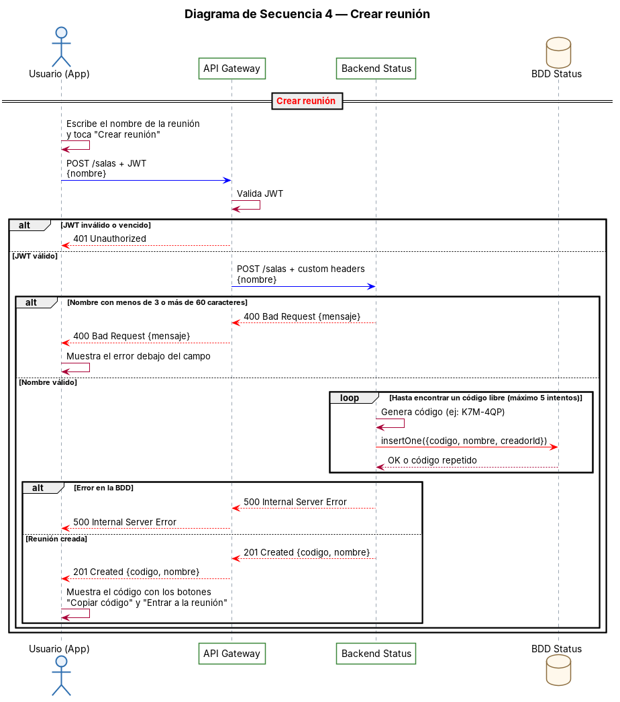

### Diagrama 5 — Entrar a una reunión

**HU5.** Como **participante**, quiero **entrar a una reunión con el código que me pasaron** para **sumarme al panel de ese grupo**.

Criterios de aceptación:
- El código se acepta en mayúsculas o minúsculas.
- Si el código no existe, la app muestra "No existe una reunión con ese código" (404) y no abre el panel.
- Si existe, se abre el panel con el nombre y el código de la reunión (200), y un botón para copiar el código.

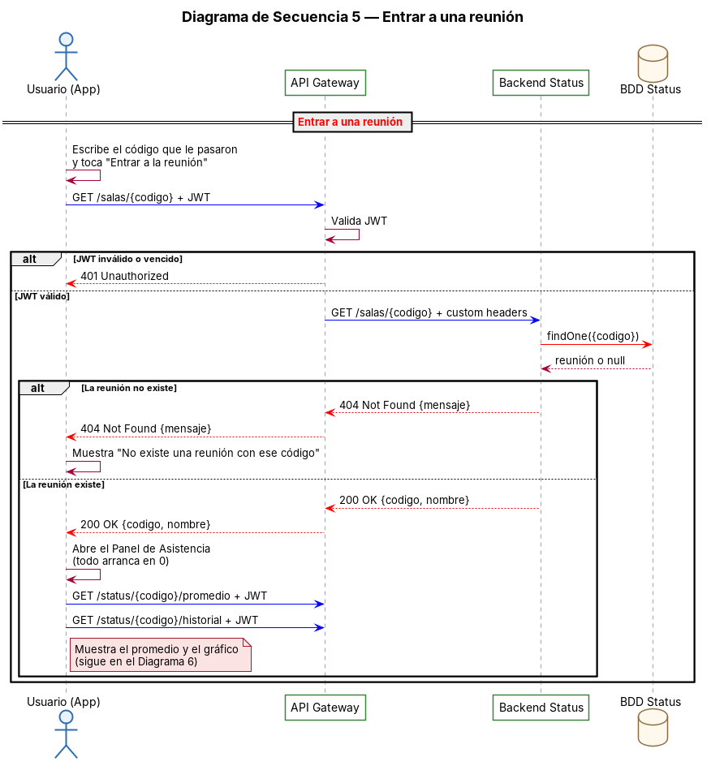

### Diagrama 6 — Actualizar y gráfico de evolución

**HU6.** Como **participante o docente**, quiero **actualizar el promedio cuando lo necesito y ver cómo fue cambiando en el tiempo** para **detectar en qué momento de la clase el grupo se perdió o se estresó**.

Criterios de aceptación:
- El botón "Actualizar" pide el promedio y el historial (200) sin guardar valores nuevos, y se desactiva mientras espera.
- El gráfico muestra una línea por variable con los últimos 30 minutos, un punto cada 15 segundos como máximo.
- Al pasar el mouse (o el dedo) se ve la hora, la cantidad de participantes y los 4 valores de ese momento.
- Los mismos datos se pueden ver en una tabla.
- La pantalla muestra la hora de la última actualización.

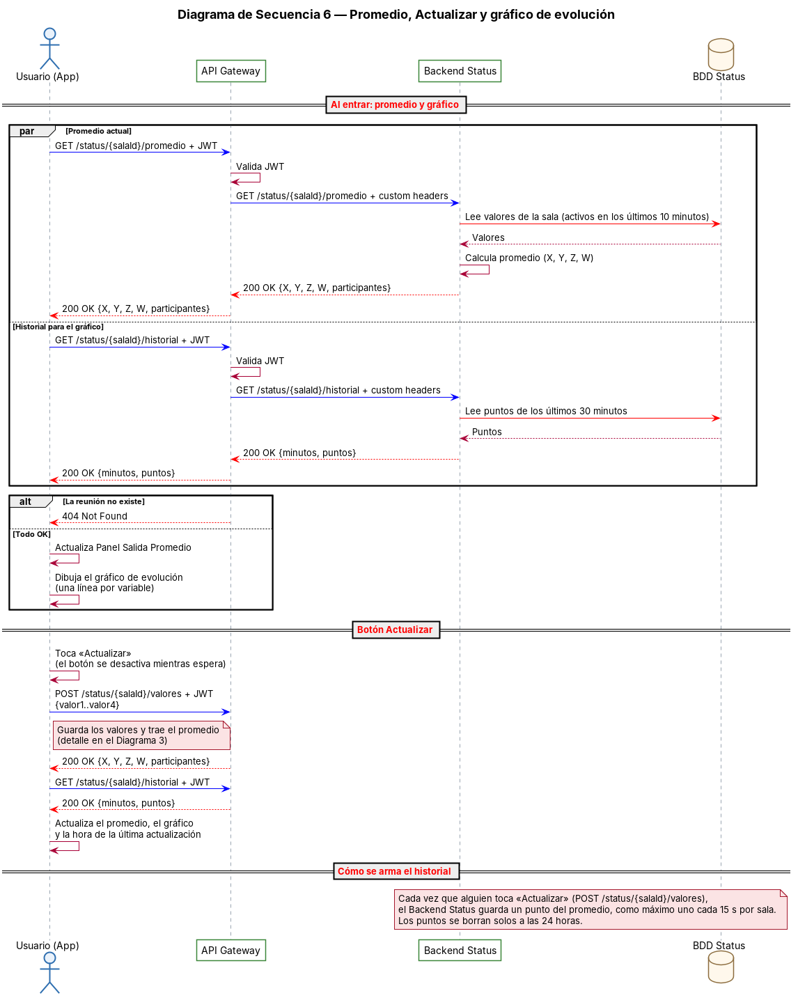

### Diagrama 7 — Salir de la reunión

**HU7.** Como **participante**, quiero **salir de la reunión** para que **mis valores dejen de contar en el promedio en ese momento**.

Criterios de aceptación:
- Al tocar "Salir de la reunión" o "Cerrar sesión", la app deja de refrescar y borra los valores del usuario en esa reunión (204).
- Si la pestaña se cierra sin salir, el usuario deja de contar en el promedio a los 45 segundos.
- Los demás participantes ven un participante menos en su próximo refresco.

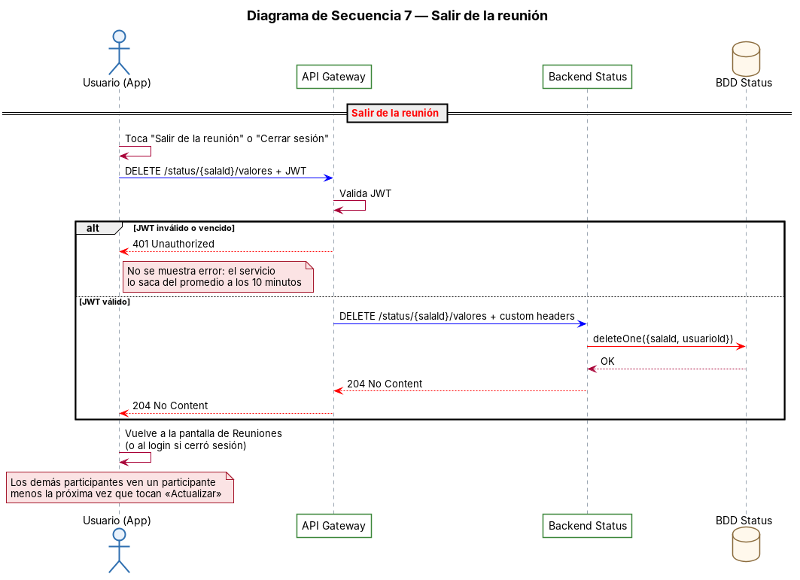

### Diagrama 8 — Sesión vencida y errores del servidor

**HU8.** Como **participante**, quiero **entender qué pasa cuando algo falla** para **saber si tengo que esperar, volver a entrar o revisar mi conexión**.

Criterios de aceptación:
- Si el JWT venció (401), la app vuelve al login con el mensaje "Tu sesión venció, volvé a iniciar sesión".
- Cada código de error muestra su propio mensaje (400, 404, 429, 500, 502, 503, 504 o sin conexión).
- Ante un error la app espera 20 segundos antes de reintentar, y 30 segundos si es un 429.
- Nunca hay dos pedidos del mismo usuario al mismo tiempo, para no saturar el servidor.

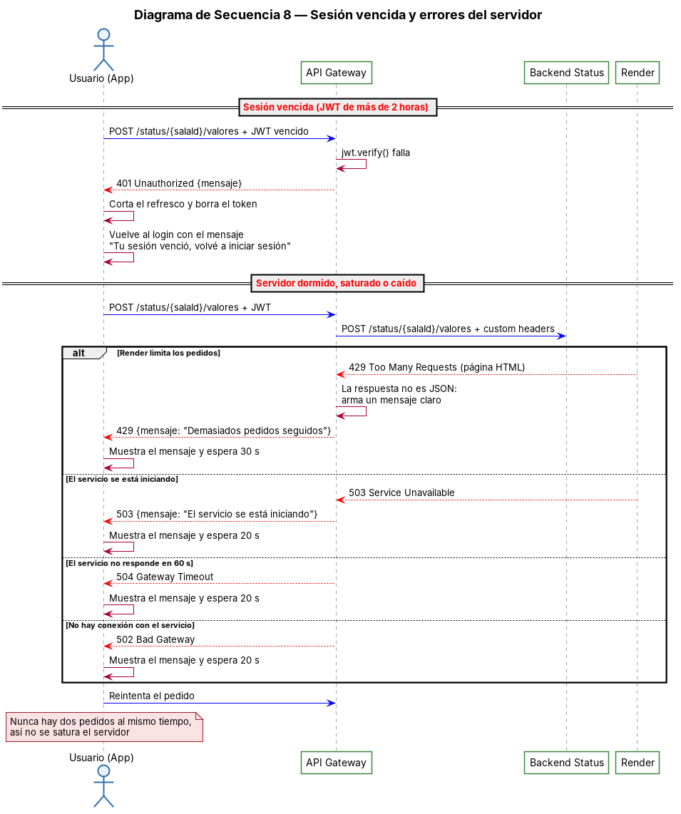

---

## 4. API

Todas las llamadas del frontend van al API Gateway.

| Método | Ruta | Necesita JWT | API | Respuestas |
|---|---|---|---|---|
| POST | `/users` | No | Usuarios | 201 creado · 400 datos inválidos · 409 ya existe |
| POST | `/session` | No | Usuarios | 201 `{token}` · 401 usuario o contraseña incorrectos |
| POST | `/salas` | Sí | Status | 201 `{codigo, nombre, creada}` · 400 nombre inválido · 401 JWT inválido |
| GET | `/salas/{codigo}` | Sí | Status | 200 `{codigo, nombre, creada}` · 401 JWT inválido · 404 no existe |
| POST | `/status/{salaId}/valores` | Sí | Status | 200 `{X, Y, Z, W, participantes}` · 400 valores inválidos · 401 JWT inválido · 404 reunión inexistente · 500 error de BDD |
| GET | `/status/{salaId}/promedio` | Sí | Status | 200 `{X, Y, Z, W, participantes}` · 401 JWT inválido · 404 reunión inexistente · 500 error de BDD |
| GET | `/status/{salaId}/historial` | Sí | Status | 200 `{minutos, puntos: [{fecha, X, Y, Z, W, participantes}]}` · 401 JWT inválido · 404 reunión inexistente |
| DELETE | `/status/{salaId}/valores` | Sí | Status | 204 sin contenido · 401 JWT inválido · 500 error de BDD |

**Cuándo llama el frontend a cada ruta**

| Acción del usuario | Pedido |
|---|---|
| Crea una reunión | `POST /salas` |
| Entra con un código | `GET /salas/{codigo}` y, ya en el panel, `POST .../valores` + `GET .../historial` |
| Suelta un slider | `POST /status/{salaId}/valores` |
| Pasan 15 segundos sin cambios | `POST /status/{salaId}/valores` (mantiene al usuario activo y trae el promedio) |
| Toca **Actualizar** | `GET /status/{salaId}/promedio` + `GET /status/{salaId}/historial` (solo leen, no guardan) |
| Toca **Salir de la reunión** o **Cerrar sesión** | `DELETE /status/{salaId}/valores` (deja de contar en el promedio) |

Un usuario cuenta en el promedio mientras haya mandado datos en los **últimos 45 segundos**. Nunca hay dos pedidos del mismo usuario al mismo tiempo.

**Manejo de errores en el frontend**

| Código | Qué ve el usuario | Qué hace la app |
|---|---|---|
| 0 (sin respuesta) | "No se pudo conectar con el servidor" | Reintenta en 20 s |
| 400 | "Los datos enviados no son válidos" | Reintenta en 20 s |
| 401 | "Tu sesión venció" | Cierra la sesión y vuelve al login |
| 404 | "No existe una reunión con ese código" | No abre el panel |
| 429 | "Demasiados pedidos seguidos" | Espera 30 s antes de reintentar |
| 500 | "Error interno del servidor" | Reintenta en 20 s |
| 502 / 503 / 504 | "El servicio no responde / se está iniciando / tardó demasiado" | Reintenta en 20 s |

El Gateway también responde con un mensaje claro cuando la ruta no existe (404), el JSON está mal formado (400) o un servicio devuelve algo que no es JSON (por ejemplo, la página de error de Render).

---

## 5. Pantallas

| Login | Registro |
|---|---|
| 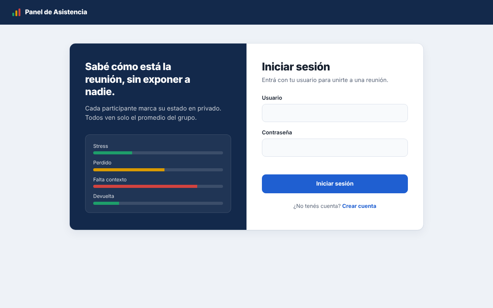 | 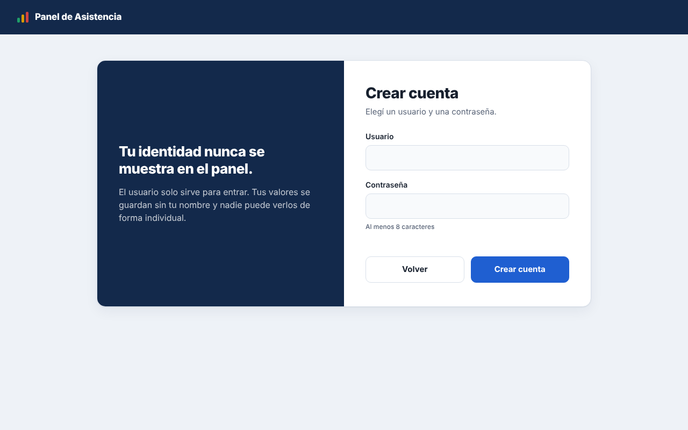 |

| Reuniones (crear o entrar) | Gráfico de evolución |
|---|---|
| 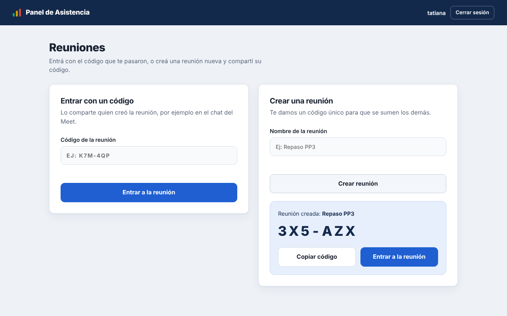 | 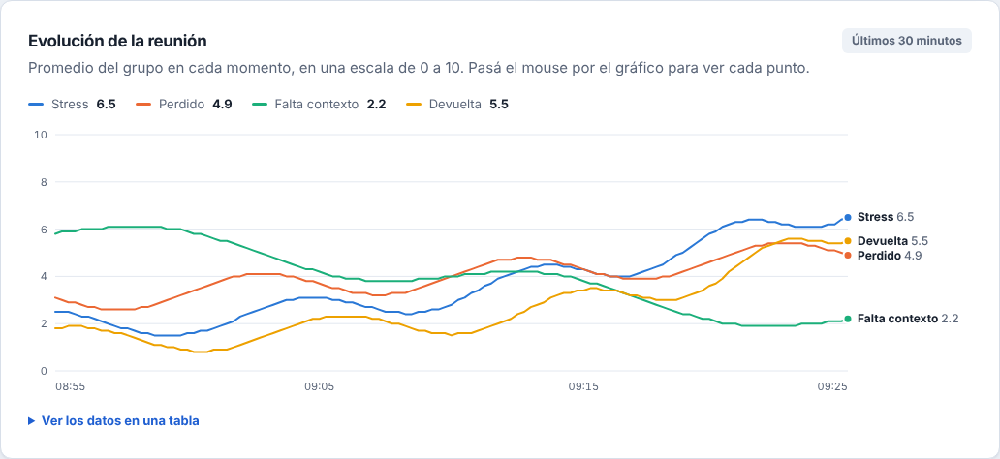 |

| Panel de Asistencia | En el celular |
|---|---|
|  | 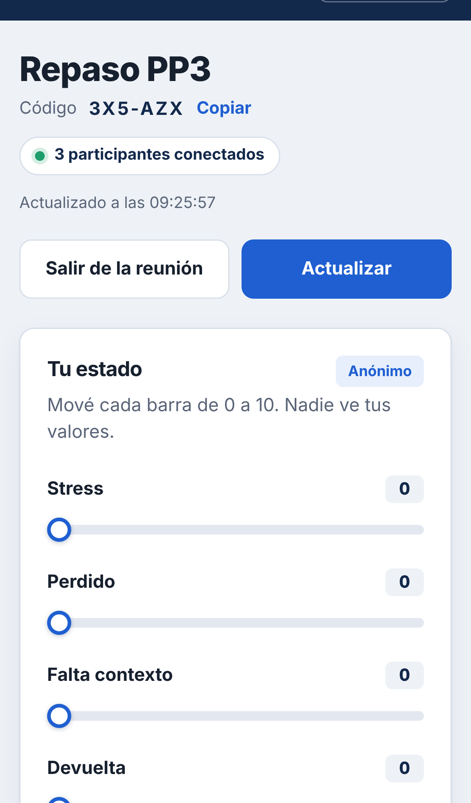 |

---

## 6. Estructura del repositorio

```
frontend/            Panel de Asistencia (index.html, css/, js/)
gateway/             API Gateway
servicio-usuarios/   API Usuarios  (index → controlador → servicio → modelo)
servicio-status/     API Status    (index → controlador → servicio → modelo)
docs/diagramas/      Arquitectura y secuencias (.puml + .png)
docs/capturas/       Capturas de las pantallas
iniciar-todo.js      Levanta todo en la compu con "npm start"
```

## 7. Cómo correrlo en la compu

Requisito: Node.js 18 o superior.

```bash
npm install
npm start
```

Abrir **http://localhost:5500**. Para simular varias personas, usar una ventana normal, una de incógnito y otro navegador, con usuarios distintos y el mismo código de reunión.

Sin `MONGO_URI`, las APIs guardan los datos en memoria (se borran al apagar). Para publicarlo, ver [`docs/DESPLIEGUE.md`](docs/DESPLIEGUE.md).
