# Panel de Asistencia de Comunicación

**PP3 — Entregable final · Grupo 7**

| Integrante | GitHub |
|---|---|
| Tatiana Peralta | [@tatianaperalta2013](https://github.com/tatianaperalta2013) |
| Pablo Nicolás Cau | @usuario |
| Luciano Budman | @usuario |
| Nahuel Álvarez | @usuario |

**MVP online:** https://URL-DEL-MVP *(completar después del despliegue)*

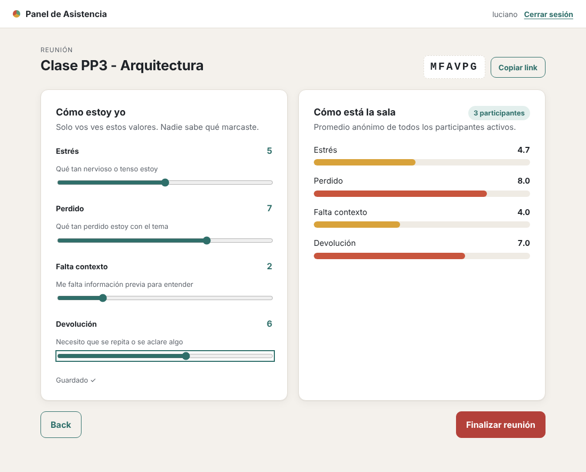

---

## 1. Descripción del proyecto

### ¿Qué problema resolvemos?

En las reuniones virtuales con muchos participantes (por ejemplo, una clase por Meet) la comunicación es casi unidireccional: quien expone habla y casi nadie pregunta. Muchas veces la gente tiene dudas o está nerviosa, pero como no ve que a los demás les pasa lo mismo, no se anima a hablar.

### ¿Cómo lo resolvemos?

Una app web que se usa **en una ventana aparte, al lado del Meet**. Cada participante marca de forma **anónima** cómo se siente con 4 sliders, y todos ven en tiempo real el **promedio de la reunión**.

Si ves que el promedio de "Perdido" está alto, sabés que no sos el único y te animás a preguntar. Y quien expone se da cuenta de que tiene que volver a explicar.

### Las 4 variables que se miden (escala de 0 a 10)

| Variable | Qué significa |
|---|---|
| **X — Estrés** | Qué tan nervioso o tenso estoy |
| **Y — Perdido** | Qué tan perdido estoy con el tema |
| **Z — Falta contexto** | Me falta información previa para entender |
| **W — Devolución** | Necesito que se repita o se aclare algo |

### Decisiones de diseño

- **Anónimo:** nadie puede ver los valores de otra persona, solo el promedio.
- **Mínimo de 3 participantes:** con menos de 3 activos no se muestra el promedio, porque con 2 personas se podría deducir lo que marcó el otro.
- **Salas:** cada reunión tiene su propia sala con un código de 6 caracteres. El promedio es solo de esa sala.
- **Participantes activos:** solo cuentan los que estuvieron conectados en los últimos 30 segundos. Si alguien cierra la pestaña, deja de contar.
- **Sin roles fijos:** cualquier usuario puede crear una reunión (pasa a ser el **anfitrión**) o unirse a una existente. Solo el anfitrión puede finalizarla.

---

## 2. Tecnologías

| Capa | Tecnología | Despliegue |
|---|---|---|
| Frontend | HTML, CSS y JavaScript | Vercel |
| API Gateway | Node.js + Express + jsonwebtoken | Render |
| Servicio Usuarios | Node.js + Express + bcryptjs + Mongoose | Render |
| Servicio Status | Node.js + Express + Mongoose | Render |
| Base de datos | MongoDB Atlas (una base por servicio) | MongoDB Atlas |
| Diagramas | PlantUML | — |

---

## 3. Arquitectura

### 3.1 Arquitectura general

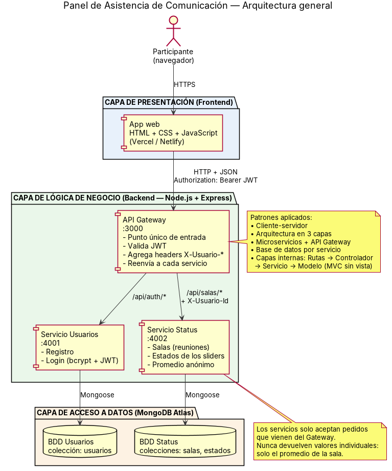

### Patrones aplicados y por qué

| Patrón | Dónde se ve | Por qué lo elegimos |
|---|---|---|
| **Cliente-servidor** | La app web pide datos y el backend responde | Es la base de cualquier app web |
| **Arquitectura en 3 capas** | Presentación (frontend), lógica (servicios), datos (MongoDB) | Cada capa se puede cambiar sin tocar las otras |
| **Microservicios** | Servicio Usuarios y Servicio Status separados | Si se cae el cálculo de promedios, el login sigue funcionando, y cada servicio se puede escalar por separado |
| **API Gateway** | Único punto de entrada (`gateway/`) | El frontend conoce una sola URL, y el JWT se valida en un solo lugar en vez de en cada servicio |
| **Base de datos por servicio** | BDD Usuarios y BDD Status | Cada servicio es dueño de sus datos; los servicios no comparten tablas |

### 3.2 Microarquitectura del servidor

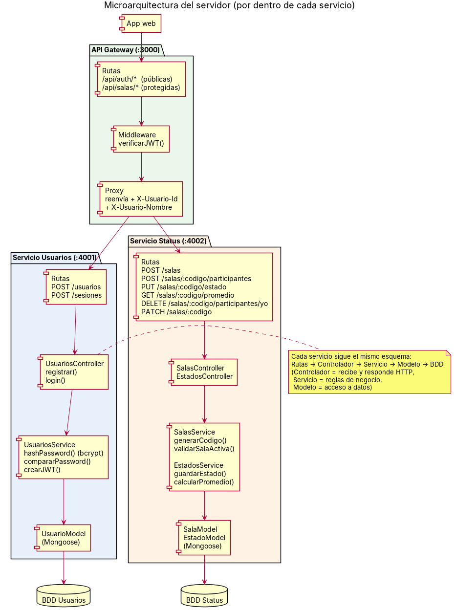

Cada servicio se organiza en las mismas capas internas, y cada capa es una carpeta dentro de `src/`:

| Capa | Carpeta | Qué hace | Ejemplo |
|---|---|---|---|
| **Rutas** | `rutas/` | Define qué URL atiende el servicio | `PUT /salas/:codigo/estado` |
| **Controlador** | `controladores/` | Recibe el pedido HTTP, llama al servicio y arma la respuesta | `estadosController.guardar()` |
| **Servicio** | `servicios/` | Reglas de negocio | `calcularPromedio()`, `validarSalaActiva()` |
| **Modelo** | `modelos/` | Único lugar que habla con la base de datos | `estadoModelo.guardarValores()` |

### 3.3 Cómo funciona la seguridad

1. En el login, el Servicio Usuarios devuelve un **JWT** que vence a las 2 horas.
2. La app manda el JWT en cada pedido: `Authorization: Bearer <token>`.
3. El **API Gateway** valida el JWT. Si es válido, reenvía el pedido al servicio agregando el header `X-Usuario-Id`.
4. Los servicios **solo aceptan pedidos que vienen del Gateway**: el Gateway manda una clave secreta en `X-Gateway-Secret`, y si falta, el servicio responde 403.
5. Las contraseñas se guardan con **bcrypt**, nunca en texto plano. En el login se busca al usuario por nombre y se compara la contraseña con `bcrypt.compare()`.

---

## 4. API

Todas las rutas pasan por el API Gateway (`/api/...`).

| Método | Ruta | Protegida | Servicio | Respuestas | Qué hace |
|---|---|---|---|---|---|
| POST | `/api/auth/registro` | No | Usuarios | 201, 400, 409 | Crea un usuario |
| POST | `/api/auth/login` | No | Usuarios | 200, 401 | Devuelve el JWT |
| POST | `/api/salas` | Sí | Status | 201, 401 | Crea una reunión y devuelve el código |
| POST | `/api/salas/:codigo/participantes` | Sí | Status | 200, 401, 404, 410 | Une al usuario a la reunión |
| PUT | `/api/salas/:codigo/estado` | Sí | Status | 204, 400, 401, 403 | Guarda los valores de los 4 sliders |
| GET | `/api/salas/:codigo/promedio` | Sí | Status | 200, 401, 410 | Devuelve el promedio de la sala |
| DELETE | `/api/salas/:codigo/participantes/yo` | Sí | Status | 204, 401 | Saca al usuario de la reunión |
| PATCH | `/api/salas/:codigo` | Sí | Status | 200, 401, 403 | El anfitrión finaliza la reunión |

### Modelo de datos

**BDD Usuarios — colección `usuarios`**
```json
{ "_id": "...", "usuario": "tati", "email": "tati@mail.com", "passwordHash": "$2a$10$...", "creadoEn": "2026-10-12T21:00:00Z" }
```

**BDD Status — colección `salas`**
```json
{ "_id": "...", "codigo": "K7M2QX", "nombre": "Clase PP3", "anfitrionId": "...", "estado": "activa", "creadaEn": "..." }
```

**BDD Status — colección `estados`**
```json
{ "_id": "...", "codigo": "K7M2QX", "usuarioId": "...", "estres": 4, "perdido": 7, "faltaContexto": 2, "devolucion": 5, "ultimaActividad": "..." }
```

---

## 5. Historias de usuario

Cada historia se corresponde con un diagrama de secuencia (HU1 ↔ S1, HU2 ↔ S2, etc.), con una pantalla y con un endpoint.

### HU1 — Registrarme
**Como** persona que participa en reuniones virtuales, **quiero** crear una cuenta con usuario, email y contraseña **para** poder usar la app.

**Criterios de aceptación**
- Si falta algún campo o el email no es válido, se muestra el error en el formulario.
- La contraseña debe tener al menos 8 caracteres y hay que escribirla dos veces.
- Si el usuario o el email ya existen, se muestra "Ese usuario o email ya está registrado".
- Si todo está bien, se muestra "Cuenta creada" y se vuelve al Login.
- La contraseña se guarda encriptada.

### HU2 — Iniciar sesión
**Como** usuario registrado, **quiero** iniciar sesión con mi usuario y contraseña **para** acceder a mis reuniones.

**Criterios de aceptación**
- Con datos correctos, entro al Home.
- Con datos incorrectos, se muestra "Usuario o contraseña incorrectos" (sin decir cuál de los dos falló).
- La sesión dura 2 horas; después tengo que volver a iniciar sesión.

### HU3 — Crear una nueva reunión
**Como** anfitrión de una reunión, **quiero** crear una sala y obtener un código o link **para** compartirlo con los participantes en el Meet.

**Criterios de aceptación**
- Al tocar "Crear reunión" se crea una sala con un código único de 6 caracteres.
- Se muestra el código y un botón "Copiar link".
- Entro directamente al Panel de la sala con mis sliders en 0.

### HU4 — Unirme a una reunión existente
**Como** participante, **quiero** ingresar el link o código de una reunión **para** sumarme al panel de esa reunión.

**Criterios de aceptación**
- Acepta el link completo o solo el código, en mayúsculas o minúsculas.
- Si abro el link sin haber iniciado sesión, después del login entro directo a la reunión.
- Si el código no existe, se muestra "No existe una reunión con ese código".
- Si la reunión ya terminó, se muestra "Esta reunión ya terminó".

### HU5 — Expresar cómo me siento de forma anónima
**Como** participante, **quiero** mover los sliders de Estrés, Perdido, Falta contexto y Devolución **para** expresar cómo me siento sin que nadie sepa que fui yo.

**Criterios de aceptación**
- Cada slider va de 0 a 10 y arranca en 0.
- El valor se guarda medio segundo después de dejar de mover el slider, y se muestra "Guardado ✓".
- Ningún otro participante puede ver mis valores individuales.
- Si hay un error al guardar, se muestra un aviso y se reintenta.

### HU6 — Ver el promedio de la reunión
**Como** participante, **quiero** ver el promedio de lo que sienten todos **para** saber si a los demás les pasa lo mismo que a mí y animarme a hablar.

**Criterios de aceptación**
- El panel muestra el promedio de las 4 variables y la cantidad de participantes activos.
- Las barras cambian de color según el nivel: verde (bajo), amarillo (medio), rojo (alto).
- Se actualiza solo, cada 3 segundos.
- Si hay menos de 3 participantes activos, se muestra "Esperando más participantes…".
- Solo cuentan los participantes conectados en los últimos 30 segundos.

### HU7 — Salir de la reunión
**Como** participante, **quiero** salir de la reunión **para** dejar de formar parte del promedio.

**Criterios de aceptación**
- Al tocar "Back" vuelvo al Home.
- Mis valores dejan de contar en el promedio inmediatamente.
- Si cierro la pestaña sin tocar "Back", dejo de contar a los 30 segundos.

### HU8 — Finalizar la reunión
**Como** anfitrión, **quiero** finalizar la reunión **para** que el panel se cierre para todos cuando termina la clase.

**Criterios de aceptación**
- Solo quien creó la reunión ve el botón "Finalizar reunión".
- Se pide confirmación antes de finalizar.
- A todos los participantes se les muestra "La reunión terminó" y vuelven al Home.
- Los valores de los participantes se borran.

---

## 6. Diagramas de secuencia

Los archivos fuente están en [`docs/diagramas/`](docs/diagramas/) en formato PlantUML (`.puml`). Para editarlos se puede pegar el código en https://www.plantuml.com/plantuml/uml/.

### S1 — Registro de usuario (HU1)
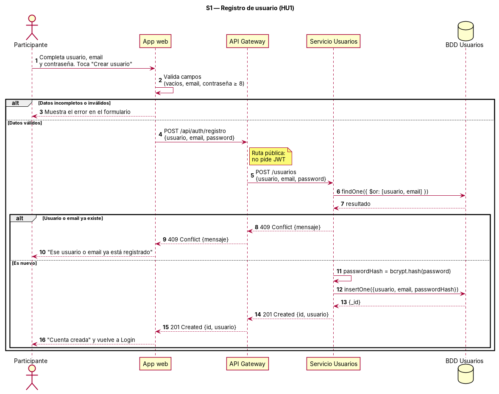

### S2 — Inicio de sesión (HU2)
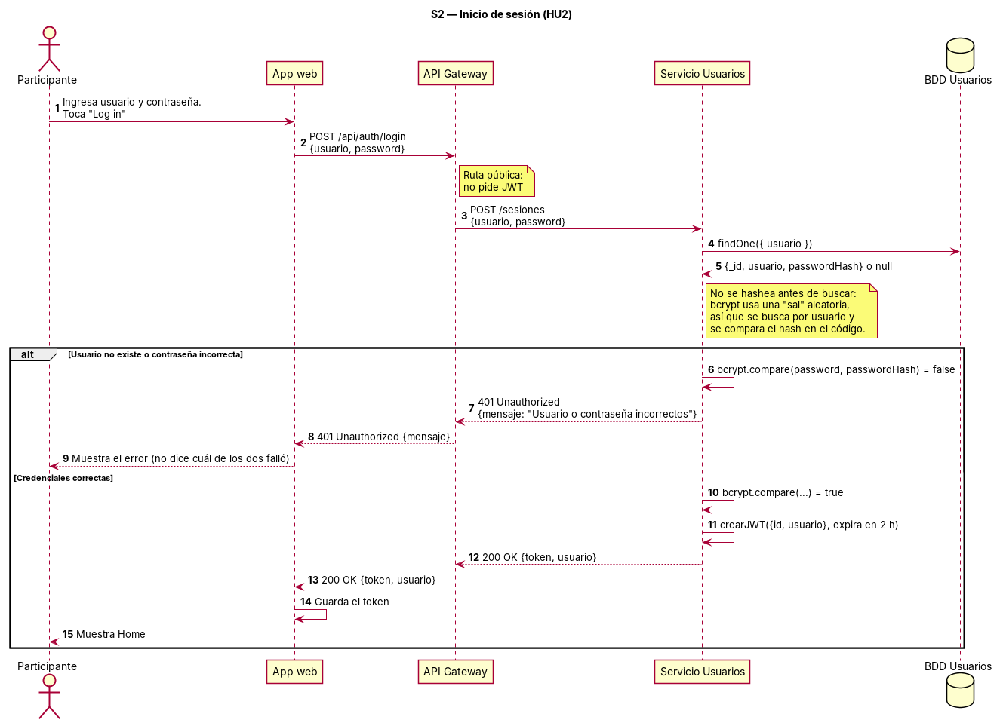

### S3 — Crear una nueva reunión (HU3)
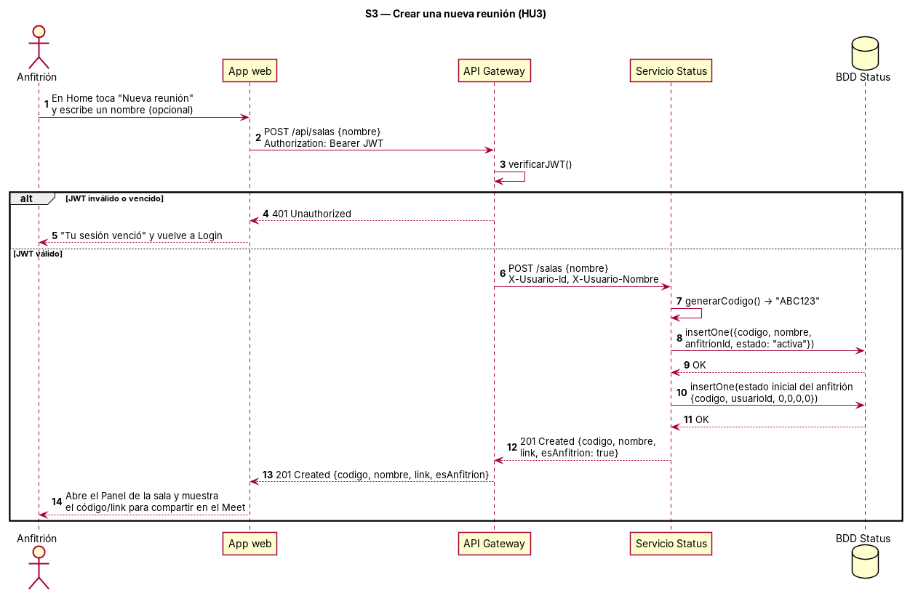

### S4 — Unirse a una reunión existente (HU4)
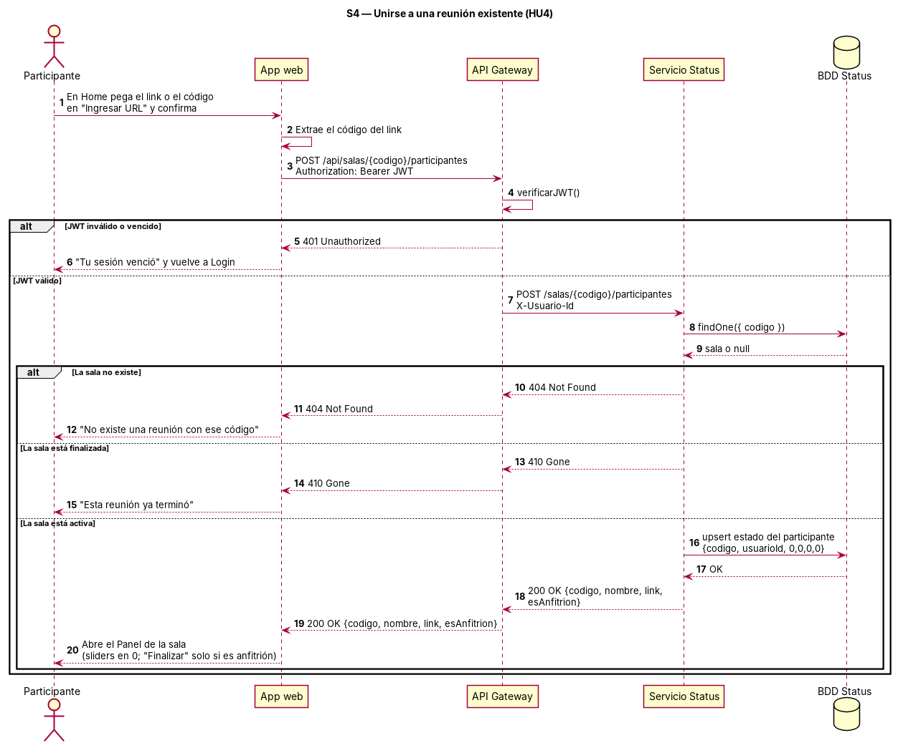

### S5 — Enviar mi estado de forma anónima (HU5)
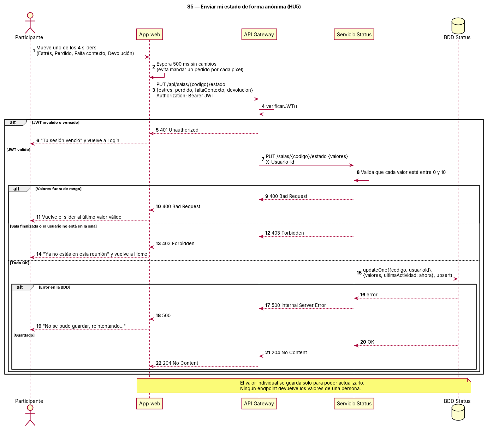

### S6 — Ver el promedio de la sala (HU6)
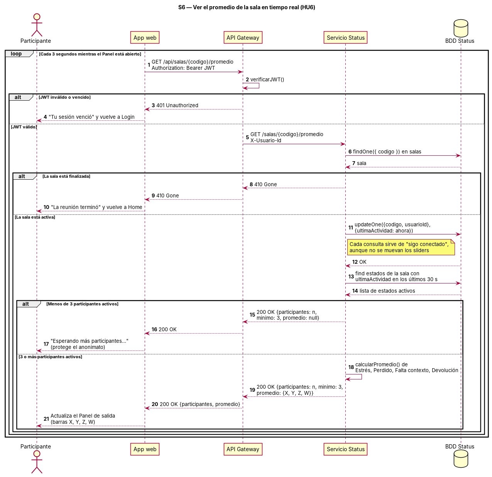

### S7 — Salir de la reunión (HU7)
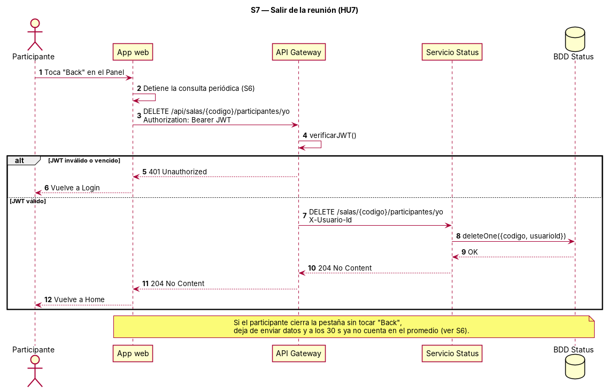

### S8 — El anfitrión finaliza la reunión (HU8)
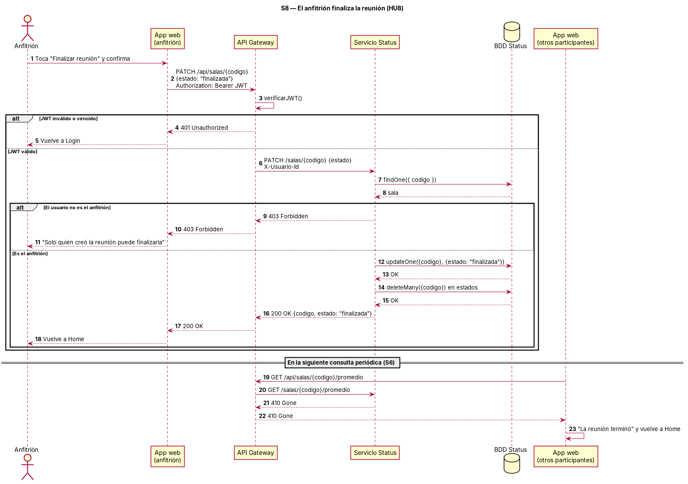

---

## 7. Pantallas

| Login (HU2) | Registro (HU1) |
|---|---|
| 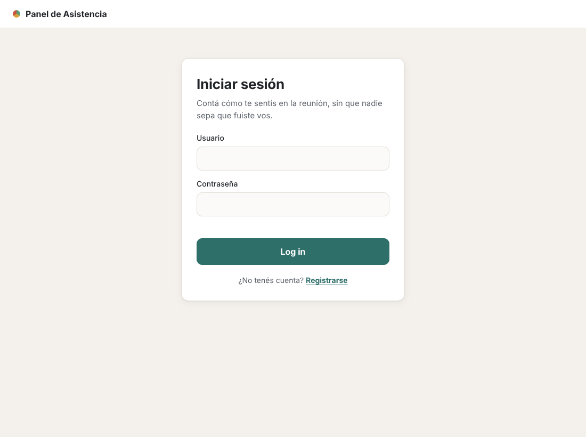 | 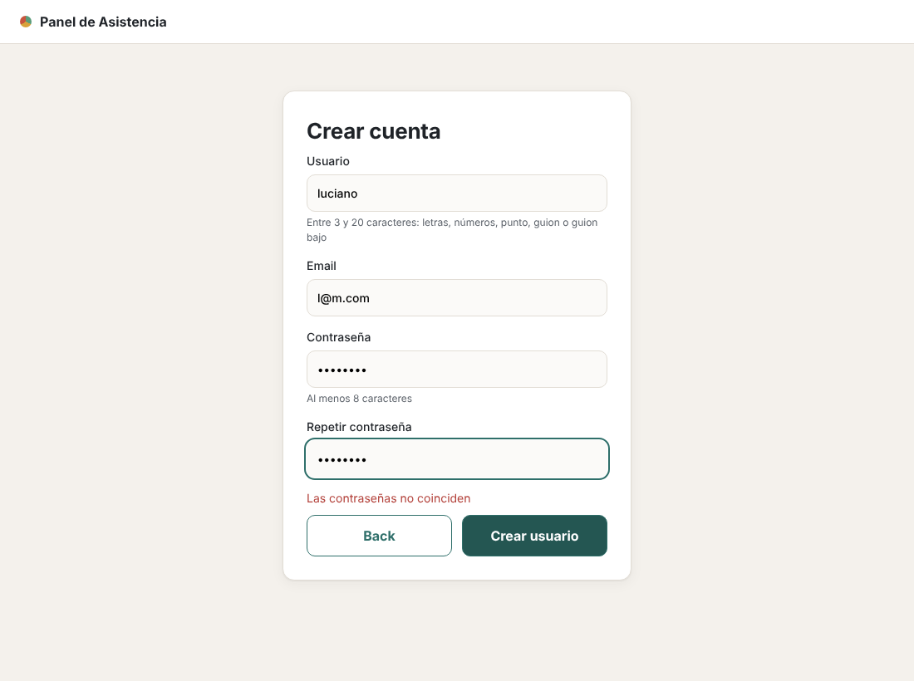 |

| Home (HU3, HU4) | Sala esperando participantes (HU6) |
|---|---|
| 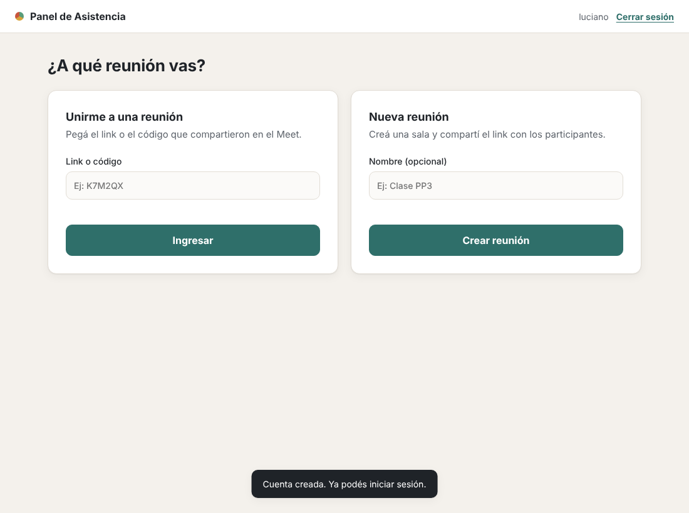 | 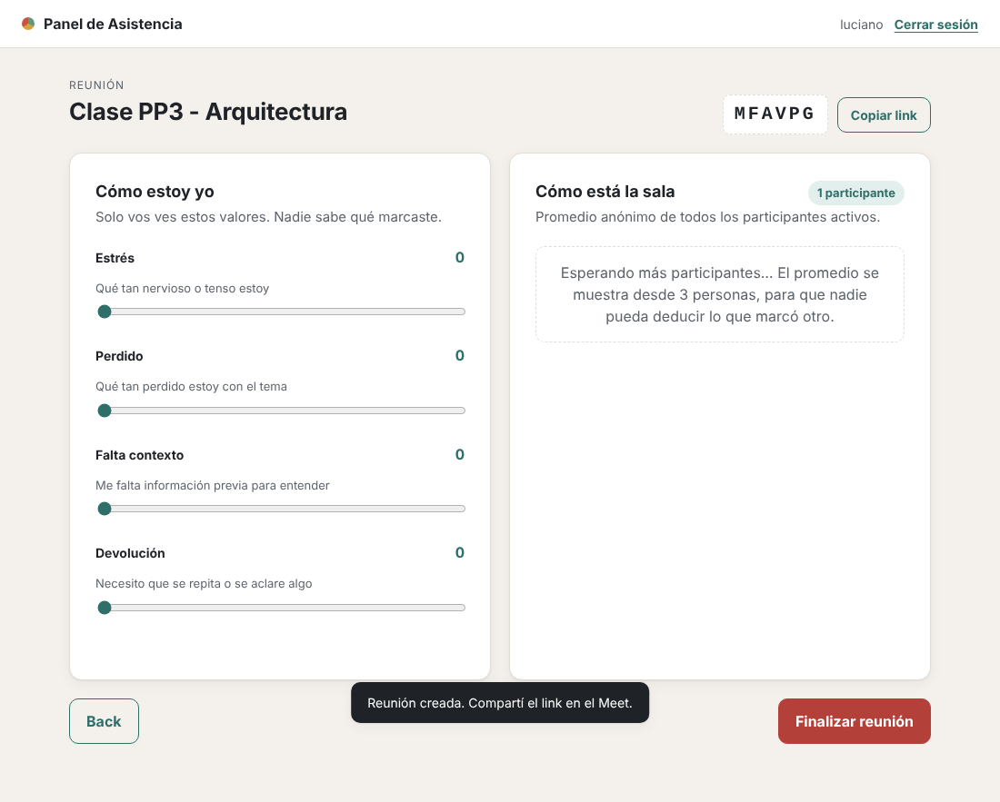 |

| Panel de la sala (HU5 a HU8) | En el celular |
|---|---|
|  | 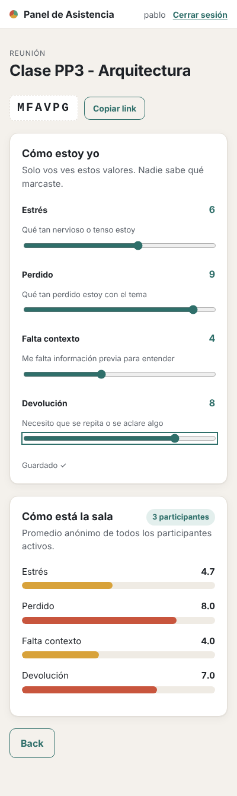 |

---

## 8. Coherencia entre entregables

| Historia | Diagrama | Pantalla | Endpoint | Código |
|---|---|---|---|---|
| HU1 Registrarme | S1 | Registro | `POST /api/auth/registro` | `usuariosService.registrar()` |
| HU2 Iniciar sesión | S2 | Login | `POST /api/auth/login` | `usuariosService.login()` |
| HU3 Crear reunión | S3 | Home → Panel | `POST /api/salas` | `salasService.crearSala()` |
| HU4 Unirme | S4 | Home | `POST /api/salas/:codigo/participantes` | `salasService.unirse()` |
| HU5 Expresar cómo me siento | S5 | Panel ("Cómo estoy yo") | `PUT /api/salas/:codigo/estado` | `estadosService.guardarEstado()` |
| HU6 Ver promedio | S6 | Panel ("Cómo está la sala") | `GET /api/salas/:codigo/promedio` | `estadosService.obtenerPromedio()` |
| HU7 Salir | S7 | Panel → Home | `DELETE /api/salas/:codigo/participantes/yo` | `salasService.salir()` |
| HU8 Finalizar | S8 | Panel (anfitrión) | `PATCH /api/salas/:codigo` | `salasService.finalizar()` |

---

## 9. Estructura del repositorio

```
/
├── frontend/                 App web (lo que ve el usuario)
│   ├── index.html
│   ├── css/estilos.css
│   └── js/
│       ├── config.js         URL del API Gateway
│       ├── api.js            Llamadas a la API
│       └── app.js            Pantallas y botones
├── gateway/                  API Gateway (valida JWT y reenvía)
├── servicio-usuarios/        Registro y login
│   └── src/ rutas/ controladores/ servicios/ modelos/ middlewares/
├── servicio-status/          Salas, estados y promedios
│   └── src/ rutas/ controladores/ servicios/ modelos/ middlewares/
├── docs/
│   ├── diagramas/            Arquitectura y secuencia (.puml + .png)
│   └── capturas/             Capturas de las pantallas
├── iniciar-todo.js           Levanta todo en la compu con "npm start"
└── README.md
```

---

## 10. Cómo correr el proyecto en tu compu

Requisito: **Node.js 18 o superior**.

```bash
git clone https://github.com/tatianaperalta2013/panel-asistencia-comunicacion.git
cd panel-asistencia-comunicacion
npm install
npm start
```

Después abrí **http://localhost:5500** en el navegador.

`npm start` levanta los 4 componentes juntos:

| Componente | Dirección |
|---|---|
| Frontend | http://localhost:5500 |
| API Gateway | http://localhost:3000 |
| Servicio Usuarios | http://localhost:4001 |
| Servicio Status | http://localhost:4002 |

**Modo memoria:** si no se configura `MONGO_URI`, los servicios guardan los datos en memoria. Sirve para probar sin crear una base de datos, pero los datos se borran al cortar el programa. Para guardar de verdad, copiar el `.env.example` de cada servicio como `.env` y completar `MONGO_URI`.

**Probar con varias personas en tu compu:** abrí la app en una ventana normal, en una ventana de incógnito y en otro navegador. Cada una puede iniciar sesión con un usuario distinto.

---

## 11. Despliegue

Ver la guía paso a paso en [`docs/DESPLIEGUE.md`](docs/DESPLIEGUE.md): MongoDB Atlas, los 3 servicios en Render y el frontend en Vercel.

---

## 12. Cómo trabajamos con Git

- Rama `main`: siempre funcionando.
- Una rama por funcionalidad: `feature/login`, `feature/salas`, etc.
- Los cambios entran a `main` por **pull request**, revisado por otro integrante.
- Mensajes de commit claros: `Agrega cálculo de promedio por sala`.

## 13. Mejoras futuras

- Reemplazar la consulta cada 3 segundos por **WebSockets**, para que escale a reuniones grandes.
- Historial de la reunión: gráfico de cómo cambió el promedio durante la clase.
- Integración directa con Google Meet.
