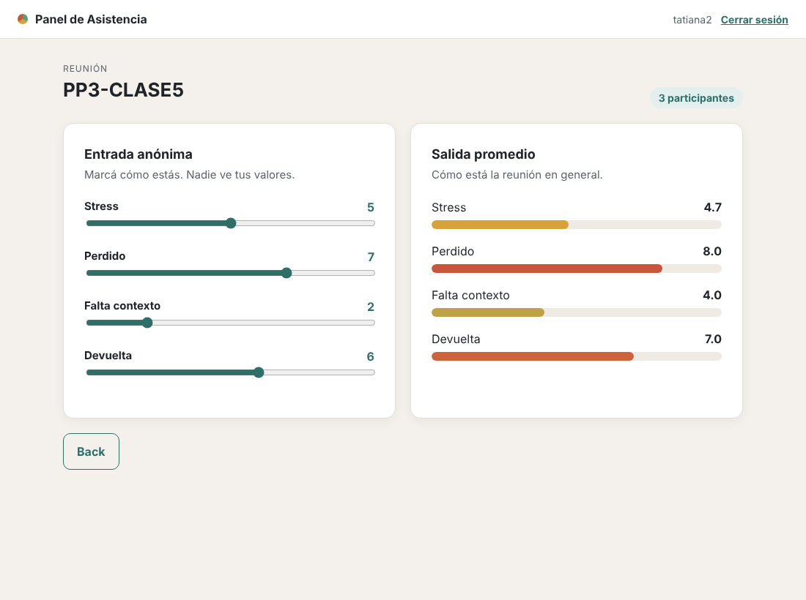
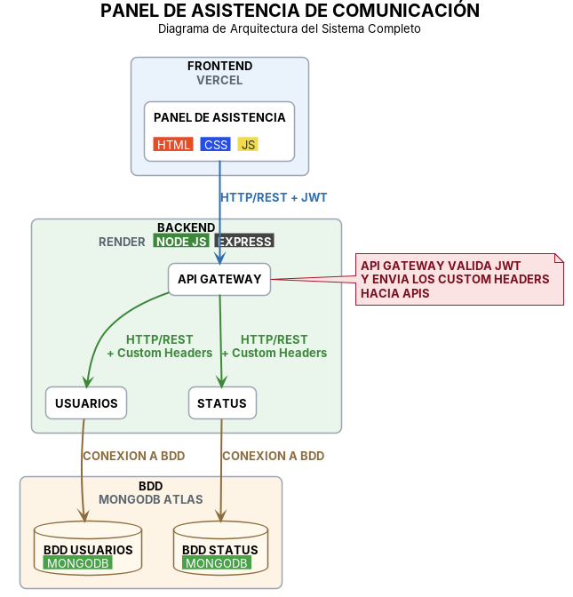
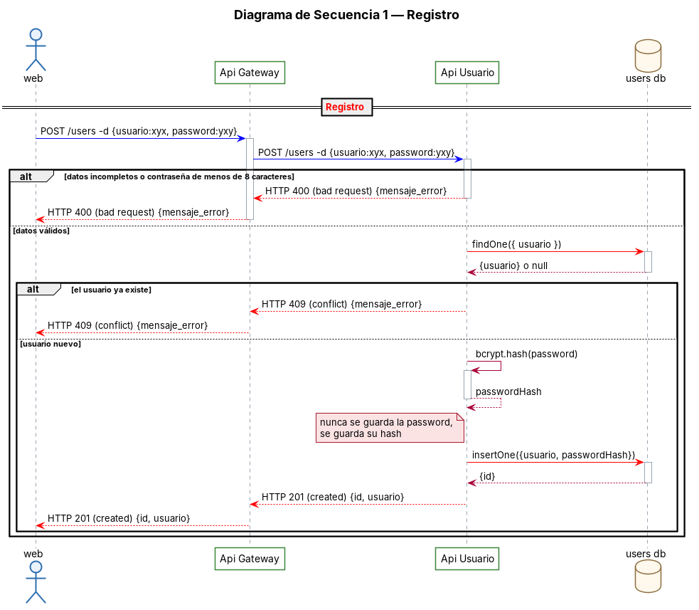
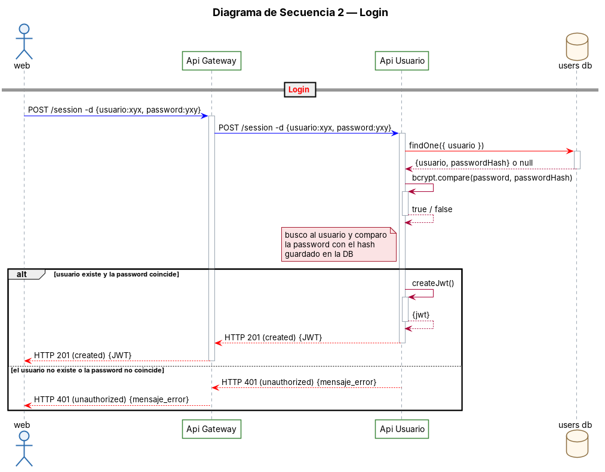
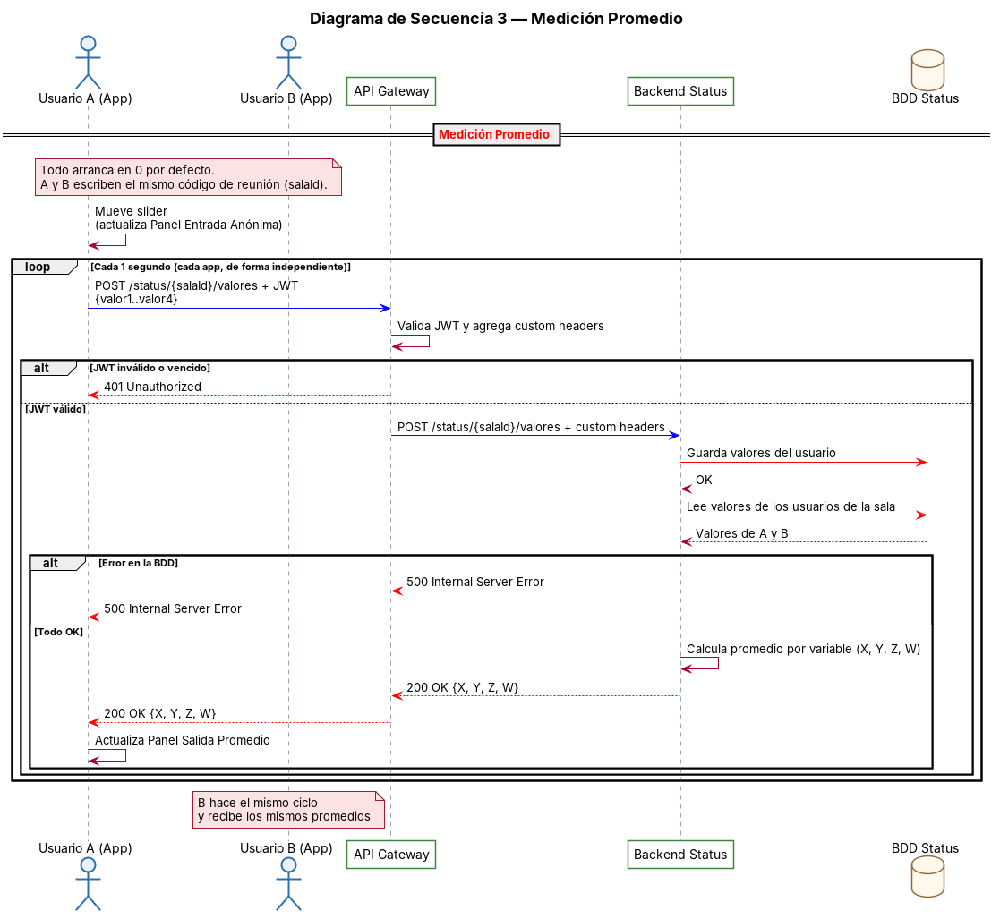
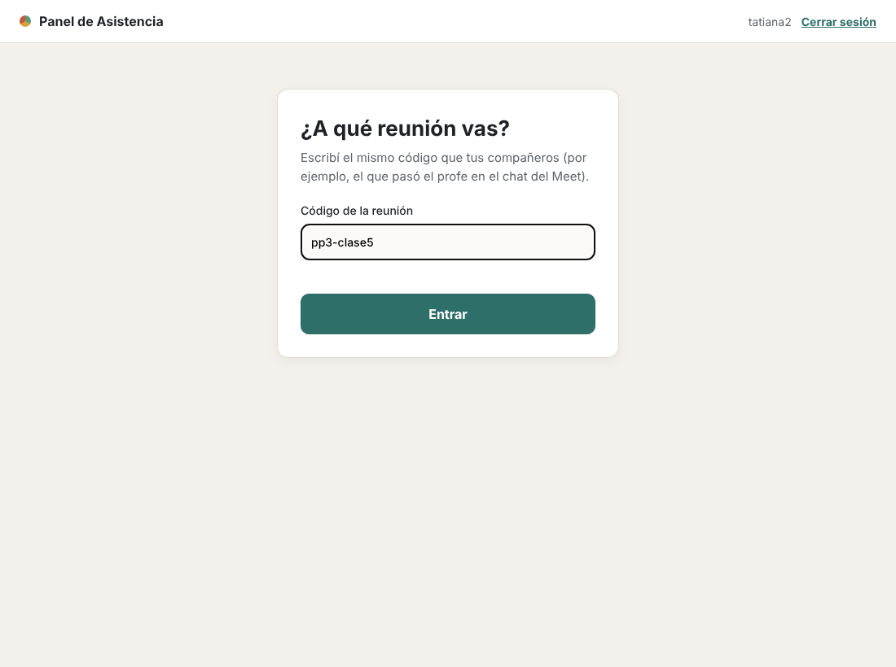
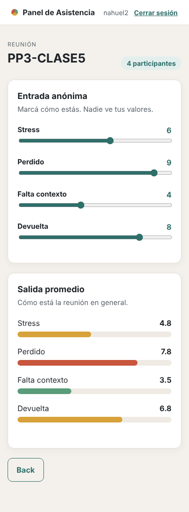

# Panel de Asistencia de Comunicación

**PP3 · Grupo 7:** Cau Pablo Nicolás · Luciano Budman · Peralta Tatiana · Álvarez Nahuel

**MVP online:** https://URL-DEL-MVP *(completar después de publicarlo)*



---

## 1. Descripción del proyecto

### ¿Qué queremos resolver?

El problema que tratamos de resolver es la falta de comunicación REAL que se da en Meets y ambientes virtuales.

¿Nunca te pasó que un profesor da una clase por Meet y ningún alumno se anima a preguntar?

Esto puede ocurrir por varios motivos, pero creemos que el motivo es simple: la comunicación es CASI unidireccional. Cuantos más miembros hay en una reunión, más se dificulta una comunicación fluida.

### Nuestra propuesta

Para mejorar la comunicación, se nos ocurrió hacer algo parecido al chat que acompaña al Meet, pero en una ventana aparte, donde TODOS los miembros de la reunión puedan saber cómo se sienten los demás (por ejemplo, su nivel de estrés o nerviosismo). Cada uno marca de forma anónima cómo está, y todos ven el promedio de la reunión. Si uno sabe que los otros miembros también están nerviosos o perdidos, se siente más habilitado para hablar, y eso mejora POTENCIALMENTE la comunicación.

| Entrada anónima (cada uno) | Salida promedio (todos ven) |
|---|---|
| Stress | X |
| Perdido | Y |
| Falta contexto | Z |
| Devuelta | W |

Si este producto, en una etapa preliminar, da resultados, conectándolo con otros sistemas podría mejorar la comunicación también fuera del Meet: en reuniones de Zoom, vivos de YouTube o capacitaciones virtuales.

### ¿Para quién es?

**Público objetivo:** institutos terciarios y universidades que dan clases virtuales en vivo (Meet, Zoom o Teams) a grupos numerosos de estudiantes. También puede usarse en capacitaciones virtuales de empresas y en reuniones de trabajo remotas con muchos participantes.

### Resumen técnico

El sistema está compuesto por **1 frontend** (el Panel de Asistencia, hecho en HTML, CSS y JavaScript y desplegado en Vercel) y **3 backends** hechos en Node.js con Express y desplegados en Render: un **API Gateway**, que es la única puerta de entrada y valida el JWT del usuario, y **2 APIs**, una de **Usuarios** (registro y login) y otra de **Status** (guarda los valores y calcula el promedio). Cada API tiene **su propia base de datos MongoDB** en MongoDB Atlas. El frontend se comunica con el API Gateway por HTTP/REST con JWT, el Gateway reenvía cada pedido a la API que corresponde agregando custom headers, y cada API se conecta solo a su propia base de datos.

---

## 2. Diagrama de arquitectura



| Componente | Carpeta | Tecnología | Base de datos | Despliegue |
|---|---|---|---|---|
| Panel de Asistencia | `frontend/` | HTML, CSS, JavaScript | — | Vercel |
| API Gateway | `gateway/` | Node.js + Express | — | Render |
| API Usuarios | `servicio-usuarios/` | Node.js + Express + bcrypt | BDD Usuarios (MongoDB) | Render |
| API Status | `servicio-status/` | Node.js + Express | BDD Status (MongoDB) | Render |

---

## 3. Diagramas de secuencia

Hechos en PlantUML. El código está en [`docs/diagramas/`](docs/diagramas/).

### Diagrama 1 — Registro


### Diagrama 2 — Login


### Diagrama 3 — Medición promedio


---

## 4. API

Todas las llamadas del frontend van al API Gateway.

| Método | Ruta | Necesita JWT | API | Respuestas |
|---|---|---|---|---|
| POST | `/users` | No | Usuarios | 201 creado · 400 datos inválidos · 409 ya existe |
| POST | `/session` | No | Usuarios | 201 `{token}` · 401 usuario o contraseña incorrectos |
| POST | `/status/{salaId}/valores` | Sí | Status | 200 `{X, Y, Z, W, participantes}` · 401 JWT inválido · 500 error de BDD |

---

## 5. Pantallas

| Login | Elegir la reunión |
|---|---|
|  |  |

| Panel de Asistencia | En el celular |
|---|---|
|  |  |

---

## 6. Estructura del repositorio

```
frontend/            Panel de Asistencia (index.html, css/, js/)
gateway/             API Gateway
servicio-usuarios/   API Usuarios  (index → controlador → servicio → modelo)
servicio-status/     API Status    (index → controlador → servicio → modelo)
docs/diagramas/      Arquitectura y secuencias (.puml + .png)
docs/capturas/       Capturas de las pantallas
iniciar-todo.js      Levanta todo en la compu con "npm start"
```

## 7. Cómo correrlo en la compu

Requisito: Node.js 18 o superior.

```bash
npm install
npm start
```

Abrir **http://localhost:5500**. Para simular varias personas, usar una ventana normal, una de incógnito y otro navegador, con usuarios distintos y el mismo código de reunión.

Sin `MONGO_URI`, las APIs guardan los datos en memoria (se borran al apagar). Para publicarlo, ver [`docs/DESPLIEGUE.md`](docs/DESPLIEGUE.md).
